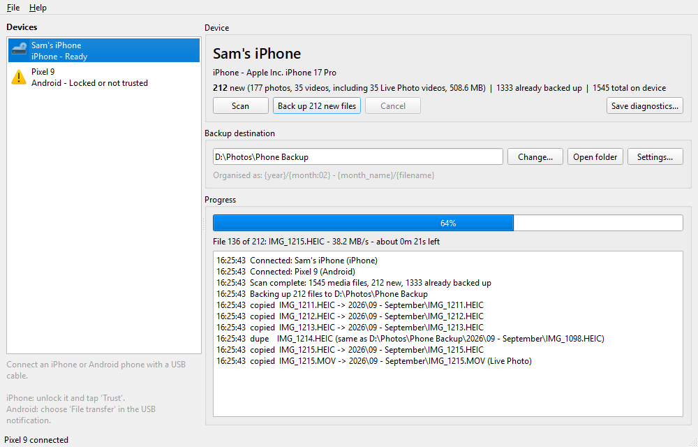

<p align="center">
  
</p>

<h1 align="center">PhotoBackup</h1>

<p align="center">
  Back up and organise photos and videos from an iPhone or Android phone to your Windows PC over USB.<br>
  No cloud, no account, no iTunes sync.
</p>

<p align="center">
  <a href="../../releases/latest">Download</a> ·
  <a href="#phone-setup">Phone setup</a> ·
  <a href="#folder-patterns">Folder patterns</a> ·
  <a href="CONTRIBUTING.md">Contributing</a>
</p>



## Features

- **Detects your phone automatically** when you plug it in over USB. It uses Windows Portable Devices (MTP), the same connection Explorer uses, so the phone doesn't need a drive letter.
- **Organises files into folders** using a pattern you choose. The default is `2026/09 - September/IMG_0001.HEIC`, and the Settings dialog shows a live preview.
- **Backs up incrementally.** Only new photos and videos are copied. A file counts as already backed up only if its name, its size, and either the phone's date or its unique file ID match. That means a new photo that reuses an old name (iPhones wrap around after `IMG_9999`) is still backed up.
- **Skips duplicates.** Identical content that was already backed up is not copied again, even if it came from another phone.
- **Keeps Live Photos together.** `IMG_0001.HEIC` and `IMG_0001.MOV` always land side by side, even when they're backed up in different runs.
- **Uses the real capture date.** Dates come from EXIF for JPEG and HEIC photos and from MediaInfo for MOV and MP4 videos, with the phone's file date as a fallback. The backed-up file's timestamp is set to that date.
- **Copies safely.** Each file is written to a hidden staging folder and moved into place only when it's complete. A cancelled or failed backup never leaves half-copied files behind.
- **Private.** The app makes no network connections and has no telemetry. Everything stays on your PC.

## Download and install

1. Download `PhotoBackup-<version>-windows-x64.zip` from the [latest release](../../releases/latest).
2. Extract it anywhere, for example `C:\Program Files\PhotoBackup` or your Desktop.
3. Run `PhotoBackup.exe`.

The exe isn't code-signed, so Windows SmartScreen may warn you the first time. Choose **More info > Run anyway**. You can also [run it from source](#running-from-source) instead.

It requires Windows 10 or 11 (64-bit).

## Phone setup

| Phone | What to do |
|---|---|
| iPhone | Install **Apple Devices** from the Microsoft Store (or iTunes) so Windows has the iPhone driver. Plug in, unlock the phone and tap **Trust**. Optionally set *Settings > Photos > Transfer to Mac or PC* to **Keep Originals**, so HEIC and HEVC files are copied unconverted. |
| Android | Plug in, unlock the phone, open the USB notification and choose **File transfer** (MTP). |

A locked or untrusted phone appears in the device list with a warning icon. It becomes ready automatically once you unlock it.

By default only the phone's `DCIM`, `Pictures` and `Movies` folders are scanned. To scan everything, turn on **Settings > Scan the whole device**; it's slower.

## Folder patterns

Set the pattern in **Settings**. Use `/` to create sub-folders.

| Token | Example |
|---|---|
| `{year}` `{month:02}` `{day:02}` | `2026` `09` `05` |
| `{month_name}` `{month_short}` | `September` `Sep` |
| `{hour:02}` `{minute:02}` `{second:02}` | `14` `30` `12` |
| `{type}` | `Photos` or `Videos` |
| `{device}` | `My iPhone` |
| `{camera}` | `iPhone 17 Pro` |
| `{filename}` `{stem}` `{ext}` | `IMG_0001.HEIC` `IMG_0001` `heic` |

Examples:

- `{type}/{year}/{month:02} - {month_name}/{filename}`
- `{device}/{year}/{month:02} - {month_name}/{filename}`
- `{year}/{month:02}/{year}{month:02}{day:02}_{hour:02}{minute:02}{second:02}_{stem}` renames each file after the date it was taken, keeping the original extension.

If two different files end up with the same name, the second one gets `_1`, `_2` and so on.

## Troubleshooting

**The phone isn't listed.** Unplug it and plug it back in, unlock it, and check the setup steps above. On Android, the USB mode often resets to "Charging only" when you reconnect.

**A backup stops partway through.** Some phones reset their USB connection during very large video transfers. Reconnect the phone and click **Back up** again; it carries on where it stopped. A different cable, a USB port directly on the PC (not a hub), and keeping the phone unlocked all help.

**Photos are missing or in the wrong folder.** Select the phone and click **Save diagnostics...**. This saves a text report of what the phone exposes: the folder tree, sample file details, counts and errors, plus the end of the app log. The report includes file and folder names, so review it before attaching it to a [bug report](../../issues/new/choose).

Settings, the backup record (`index.db`) and the log are stored in `%APPDATA%\PhotoBackup`. If you delete a backed-up file from the destination folder, the next backup copies it again.

## Running from source

Requires Python 3.10 or newer on Windows.

```powershell
git clone <this repository>
cd photobackup
python -m pip install -e ".[dev]"
python run.py
```

Run the tests with `python -m pytest`.

To build the standalone exe:

```powershell
python -c "import photobackup.devices.wpd as w; w._libs()"   # generate the Windows device (WPD) COM wrappers
python -m PyInstaller build.spec --noconfirm
```

The output is `dist\PhotoBackup\PhotoBackup.exe`. Distribute the whole `dist\PhotoBackup` folder.

## Project layout

```
photobackup/
  main.py                 app entry point
  config.py               settings (JSON in %APPDATA%\PhotoBackup)
  devices/wpd.py          Windows Portable Devices COM wrapper
  devices/watcher.py      background thread that detects devices
  devices/diagnostics.py  device diagnostics report
  core/scanner.py         finds photos and videos on a device
  core/metadata.py        date taken and camera model (EXIF / HEIC / MediaInfo)
  core/organiser.py       folder pattern engine
  core/index_db.py        SQLite backup record
  core/backup_worker.py   scan and copy pipeline, plus the worker threads
  ui/main_window.py       main window
  ui/settings_dialog.py   settings dialog
  assets/                 logo and Windows icon
tests/                    pytest suite (no phone needed)
```

## Licence

PhotoBackup is free software, released under the [GNU General Public License v3.0 or later](LICENSE). Bundled third-party components and their licences are listed in [THIRD_PARTY_NOTICES.md](THIRD_PARTY_NOTICES.md).
